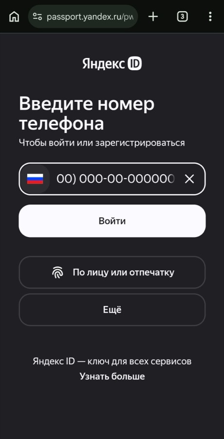
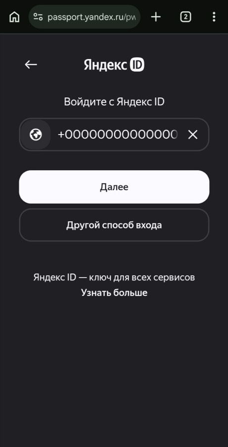
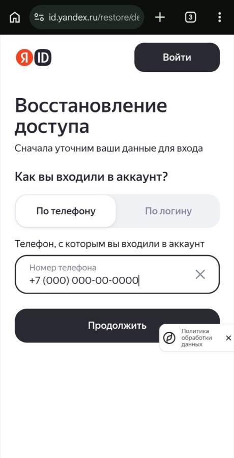

# BUG-001 — Поле номера пропускает лишние цифры, два экрана входа ведут себя по-разному

**Краткое описание:** в поле номера телефона можно ввести больше цифр, чем предусматривает маска +7 (XXX) XXX-XX-XX. На одном экране входа флаг страны при этом меняется на глобус, на другом остаётся российским.

**Окружение:** Samsung Galaxy S24 FE, Android 16, One UI 8.5, Google Chrome 155.0.8059.81; ya.ru → passport.yandex.ru
**Severity:** Minor
**Priority:** Low
**Дата:** 20.10.2026
**Статус:** открыт; ожидаемое поведение — предположение, см. «Примечания»

---

## Шаги воспроизведения

**Экран «Введите номер телефона»**
1. Открыть ya.ru и перейти ко входу в Яндекс ID.
2. На экране «Введите номер телефона» с флагом России ввести 14 цифр после +7.

**Экран «Войдите с Яндекс ID»**
3. Открыть форму «Войдите с Яндекс ID» с кнопками «Далее» и «Другой способ входа».
4. Ввести те же 14 цифр.

## Ожидаемый результат

Поле не даёт ввести больше 10 цифр после +7, как подсказывает маска. Оба экрана входа ведут себя одинаково.

## Фактический результат

- **«Введите номер телефона»:** лишние цифры дописываются в конец поля, маска «съезжает» (видно `00) 000-00-000000`), флаг остаётся российским.
- **«Войдите с Яндекс ID»:** длина тоже не ограничена, но флаг сменяется глобусом, а номер показывается без маски.
- На обоих экранах после отправки — «Недопустимый формат номера», дальше сервис не пускает. Ошибочный номер не принимается, страдает только удобство.

## Вложения

 

*Слева — экран «Введите номер телефона», справа — «Войдите с Яндекс ID». Ввод одинаковый, поведение разное.*

## Примечания

Справка Яндекс ID не описывает формат и длину номера. Ожидание «не больше 10 цифр после +7» основано на маске поля и стандартном формате номера РФ.

Пользователь, который ошибся и ввёл лишнюю цифру, узнаёт об ошибке только после отправки, хотя поле могло бы просто не принять её.

Похожее поведение замечено на странице восстановления доступа: в поле телефона можно ввести 11-ю цифру после +7, кнопка «Продолжить» становится активной. Сценарий восстановления не входил в область тестирования и дальше не проверялся.

