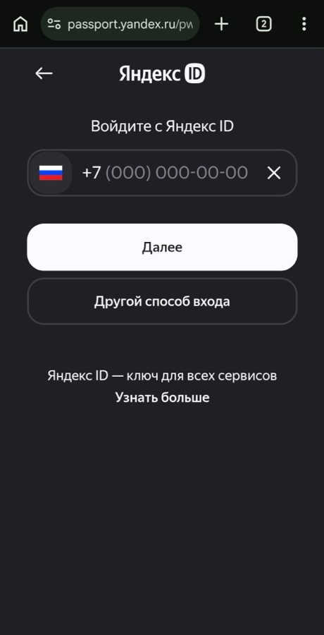
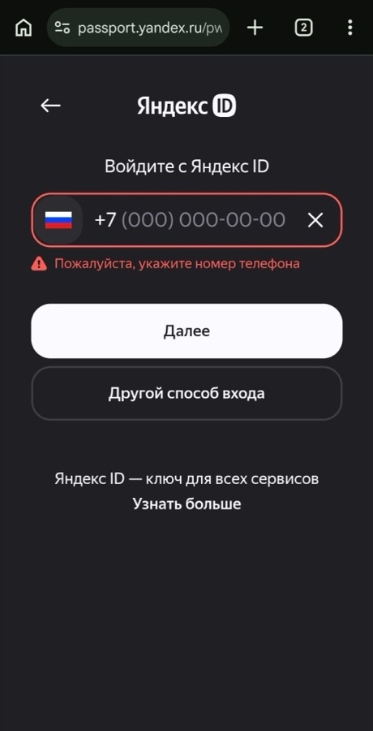
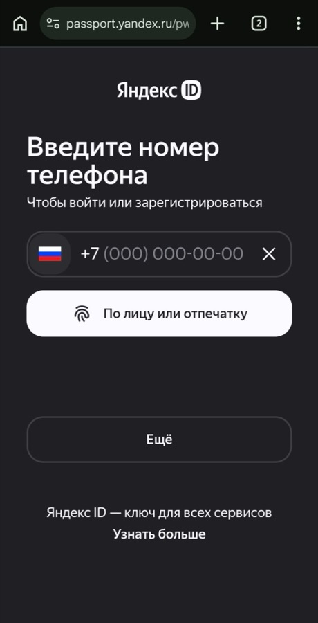
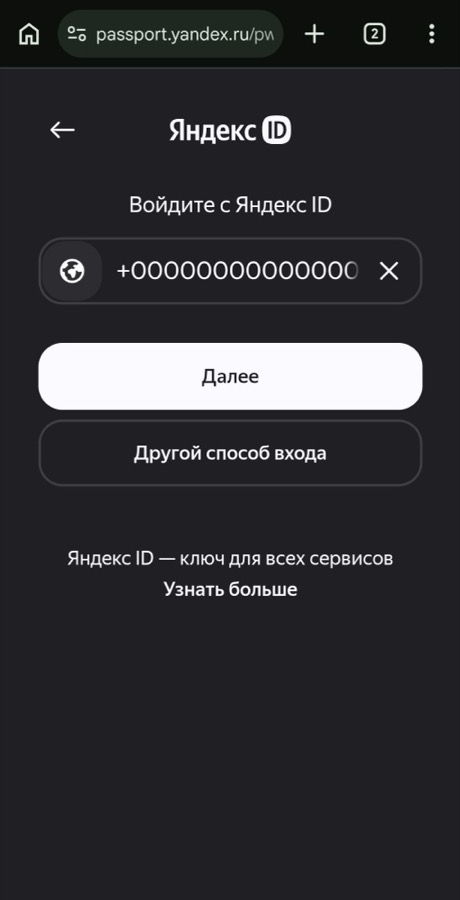
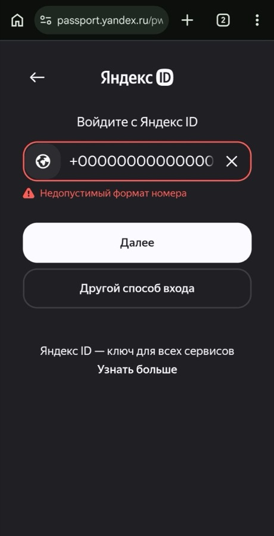
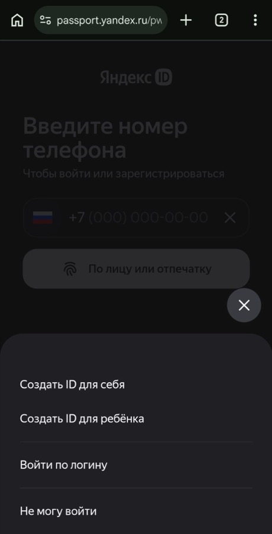
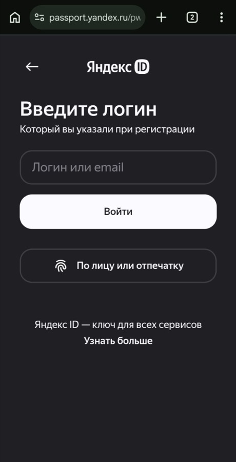
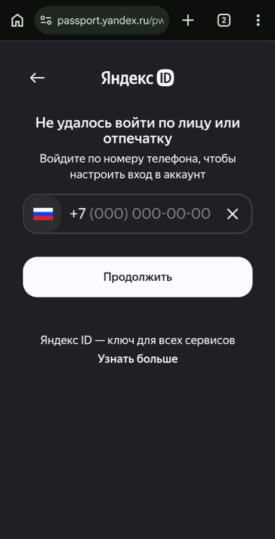
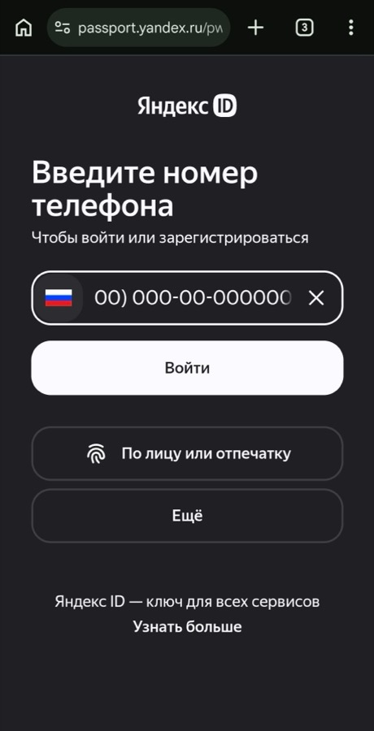

# Тест-кейсы: вход в Яндекс ID с мобильного браузера

Выполнены 20.10.2026. Окружение и область тестирования — в [README проекта](README.md).

## Сводка

| ID | Название | Приоритет | Тип | Результат |
|---|---|---|---|---|
| [TC-AUTH-001](#tc-auth-001--пустой-номер-телефона) | Пустой номер телефона | Medium | негативный | Pass |
| [TC-AUTH-002](#tc-auth-002--номер-длиннее-формата-на-экране-войдите-с-яндекс-id) | Номер длиннее формата на экране «Войдите с Яндекс ID» | Medium | негативный | Pass, см. [BUG-001](BUG-001-phone-mask-overflow.md) |
| [TC-AUTH-003](#tc-auth-003--успешный-вход-по-номеру-телефона) | Успешный вход по номеру телефона | High | позитивный | Pass |
| [TC-AUTH-004](#tc-auth-004--неверный-код-подтверждения) | Неверный код подтверждения | High | негативный | Pass |
| [TC-AUTH-005](#tc-auth-005--переход-к-другому-способу-входа) | Переход к другому способу входа | Low | функциональный | Pass |
| [TC-AUTH-006](#tc-auth-006--успешный-вход-по-логину) | Успешный вход по логину | High | позитивный | Pass |
| [TC-AUTH-007](#tc-auth-007--пустой-логин) | Пустой логин | Medium | негативный | Pass |
| [TC-AUTH-008](#tc-auth-008--несуществующий-логин) | Несуществующий логин | Medium | негативный | Pass |
| [TC-AUTH-009](#tc-auth-009--неудачный-вход-по-лицу-или-отпечатку) | Неудачный вход по лицу или отпечатку | Medium | негативный | Pass |
| [TC-AUTH-010](#tc-auth-010--номер-длиннее-формата-на-экране-введите-номер-телефона) | Номер длиннее формата на экране «Введите номер телефона» | Medium | негативный | Pass, см. [BUG-001](BUG-001-phone-mask-overflow.md) |

**Итог:** 10 из 10 выполнены, все Pass. Отдельно оформлена одна находка — [BUG-001](BUG-001-phone-mask-overflow.md): маска номера пропускает лишние цифры, а два экрана входа ведут себя по-разному.

**Общее предусловие для всех кейсов:** пользователь не авторизован, сайт ya.ru открыт в Chrome, выполнен переход к форме входа Яндекс ID.

---

## TC-AUTH-001 — Пустой номер телефона

**Приоритет:** Medium · негативный

**Шаги**
1. Открыть форму «Войдите с Яндекс ID».
2. Оставить поле телефона пустым.
3. Нажать «Далее».

**Ожидаемый результат:** переход не выполняется, под полем сообщение «Пожалуйста, укажите номер телефона», поле выделено как ошибочное.

**Фактический результат:** под полем сообщение «Пожалуйста, укажите номер телефона», поле выделено красным, пользователь остаётся на форме.

**Дополнительно:** на втором варианте экрана — «Введите номер телефона» — при пустом поле кнопки «Войти» нет совсем, она появляется только после начала ввода. Если ввести +7 и 4 цифры и нажать «Войти», сервис показывает «Недопустимый формат номера» и дальше не пускает.

  

*Слева направо: пустая форма «Войдите с Яндекс ID»; сообщение после нажатия «Далее»; экран «Введите номер телефона», где при пустом поле кнопки «Войти» нет.*

**Результат:** Pass

---

## TC-AUTH-002 — Номер длиннее формата на экране «Войдите с Яндекс ID»

**Приоритет:** Medium · негативный

**Шаги**
1. Открыть форму «Войдите с Яндекс ID».
2. Ввести подряд больше 11 цифр.
3. Нажать «Далее».

**Ожидаемый результат:** номер не принимается, сообщение «Недопустимый формат номера», переход не выполняется.

**Фактический результат:** поле не ограничивает длину ввода. Как только ввод перестаёт походить на номер РФ, флаг России сменяется значком глобуса. После «Далее» — сообщение «Недопустимый формат номера», поле выделено красным, переход не выполнен.

 

**Результат:** Pass. Отсутствие ограничения длины вынесено в [BUG-001](BUG-001-phone-mask-overflow.md).

---

## TC-AUTH-003 — Успешный вход по номеру телефона

**Приоритет:** High · позитивный

**Предусловие:** есть тестовый аккаунт с привязанным номером, телефон под рукой.

**Шаги**
1. На форме входа ввести номер тестового аккаунта и нажать «Далее».
2. Ввести код из пуш-уведомления.
3. Если к номеру привязано несколько аккаунтов, выбрать нужный.
4. Проверить, в какой аккаунт выполнен вход.

**Ожидаемый результат:** вход выполнен в нужный аккаунт, ошибок нет.

**Фактический результат:** код пришёл пуш-уведомлением, а не СМС. К номеру привязано несколько аккаунтов, сервис предложил выбрать профиль. После выбора вход выполнен в нужный аккаунт.

**Результат:** Pass. Скриншоты не прикладываются: на экранах номер телефона и данные аккаунта.

---

## TC-AUTH-004 — Неверный код подтверждения

**Приоритет:** High · негативный

**Шаги**
1. Начать вход по номеру тестового аккаунта, дойти до ввода кода.
2. Ввести заведомо неверный код.
3. Повторить ещё 2 раза подряд.

**Ожидаемый результат:** каждый неверный код отклоняется. После нескольких неудачных попыток сервис ограничивает дальнейший ввод.

**Фактический результат:** после каждого неверного кода поле подсвечивается красным, сообщение «Неверный код». После 3-й попытки — «Произошла ошибка. Попробуйте позже», ввод кода временно недоступен. Вход не выполнен.

**Результат:** Pass

---

## TC-AUTH-005 — Переход к другому способу входа

**Приоритет:** Low · функциональный

**Шаги**
1. На экране входа нажать «Ещё» (на другом варианте экрана — «Другой способ входа»).
2. Выбрать «Войти по логину».
3. Нажать стрелку «назад» у заголовка «Яндекс ID».

**Ожидаемый результат:** открывается список способов входа, затем форма логина; «назад» возвращает на предыдущий экран без ошибок.

**Фактический результат:** так и происходит. В меню есть пункты «Создать ID для себя», «Создать ID для ребёнка», «Войти по логину», «Не могу войти».

 

**Результат:** Pass

---

## TC-AUTH-006 — Успешный вход по логину

**Приоритет:** High · позитивный

**Шаги**
1. «Ещё» → «Войти по логину».
2. Ввести логин тестового аккаунта, нажать «Войти».
3. Подтвердить вход кодом из пуш-уведомления.

**Ожидаемый результат:** вход выполнен в нужный аккаунт.

**Фактический результат:** после ввода логина открылся экран подтверждения с кодом из пуш-уведомления, там же предложен способ «Войти по картинке». После ввода кода вход выполнен в нужный аккаунт.

**Результат:** Pass. Скриншоты не прикладываются: на экранах логин аккаунта.

---

## TC-AUTH-007 — Пустой логин

**Приоритет:** Medium · негативный

**Шаги**
1. «Ещё» → «Войти по логину».
2. Оставить поле «Логин или email» пустым, нажать «Войти».

**Ожидаемый результат:** переход не выполняется, показано сообщение об ошибке.

**Фактический результат:** сообщение «Вы не ввели адрес электронной почты.», пользователь остаётся на форме.

**Результат:** Pass

---

## TC-AUTH-008 — Несуществующий логин

**Приоритет:** Medium · негативный

**Шаги**
1. «Ещё» → «Войти по логину».
2. Ввести заведомо несуществующий логин, например `qa_nonexistent_84721`, нажать «Войти».

**Ожидаемый результат:** доступ не предоставлен, понятное сообщение.

**Фактический результат:** сообщение «Нет аккаунта с таким логином. Возможно, он удалён или его никогда не было.» Доступ не предоставлен.

**Результат:** Pass

---

## TC-AUTH-009 — Неудачный вход по лицу или отпечатку

**Приоритет:** Medium · негативный

**Шаги**
1. Нажать «По лицу или отпечатку».
2. Отменить биометрическую проверку.
3. Нажать «Продолжить» на следующем экране.

**Ожидаемый результат:** сообщение о неудаче, предложение войти по номеру телефона, доступа к аккаунту нет.

**Фактический результат:** экран «Не удалось войти по лицу или отпечатку» с текстом «Войдите по номеру телефона, чтобы настроить вход в аккаунт» и кнопкой «Продолжить». Кнопка ведёт к вводу номера. Доступ не предоставлен.

**Результат:** Pass

---

## TC-AUTH-010 — Номер длиннее формата на экране «Введите номер телефона»

**Приоритет:** Medium · негативный

**Шаги**
1. Открыть экран «Введите номер телефона», флаг России.
2. Ввести на 4 цифры больше, чем 10 цифр после +7.
3. Нажать «Войти».

**Ожидаемый результат:** номер не принимается, сообщение «Недопустимый формат номера».

**Фактический результат:** лишние цифры дописываются в конец поля, флаг остаётся российским (в отличие от TC-AUTH-002, где он меняется на глобус). После «Войти» — «Недопустимый формат номера», переход не выполнен.

**Результат:** Pass. Расхождение с TC-AUTH-002 вынесено в [BUG-001](BUG-001-phone-mask-overflow.md).
